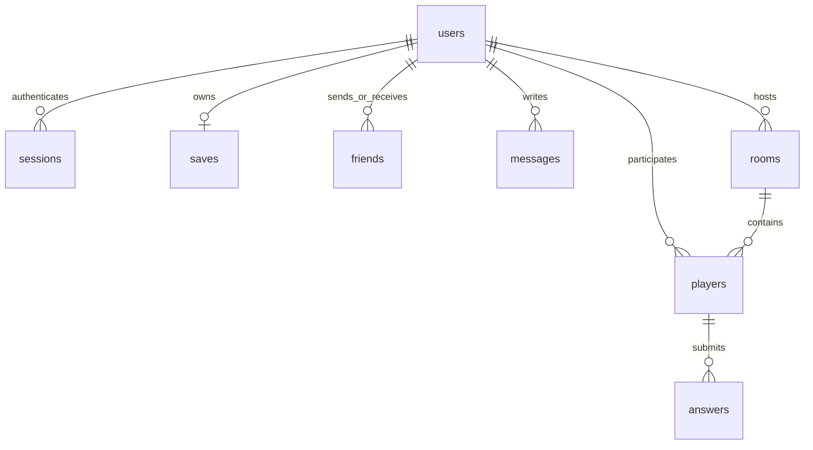

*This project has been created as part of the 42 curriculum by yemirosh, mpeskov, lbellmas, bsamy.*

# NULL CITY — SIGNAL LOST (1.0)

## Description

NULL CITY is a Russian, English and Spanish cyberpunk learning RPG and multiplayer knowledge
club. The first story follows an operator investigating a resident erased from a
city registry. Eleven cases across two chapters introduce files, routing, DNS, evidence, containment,
reporting, phishing checks, least privilege, backup recovery and responsible disclosure.
Five walkable interiors connect optional stories, a radio station, a memory archive
and an XP clothing shop. Chapter two has two persistent endings, 850 additional XP
and visible changes to the city after recovery and broadcast. Existing saves continue
from case eight without resetting appearance or purchases.
The capital map connects four districts with progression gates, three new terminal operations and a final confrontation with REGENT. District progress and one-time XP rewards survive reloads; see [capital notes](docs/CAPITAL.md).
The identity editor has original 32×48 source sprites displayed at the original 16×24 world scale, seven hairstyles, custom
skin/hair/eye colours, gender selection and directional animated previews.

The main menu includes Multiplayer, Sign in / Register, and a campaign dossier with six achievement milestones. The multiplayer lobby supports atomic quick match, public invitation links, ready checks, host transfer and shared opt-in rematches. A daily learning contract rewards three correct answers in completed matches once per UTC day. See [release notes](docs/RELEASE-1.0.md).

The HTTPS club adds email/password accounts, editable profiles, raster avatars,
friends, a live public chat and a server-authoritative 2–4-player quiz arena. It
has spectators, one-use hints, configurable topics/timers, match history, badges,
XP/levels and a leaderboard. OSCP/Security+ routes currently contain an outline
and one introductory activity each; they are not complete certification courses.

The city uses native Canvas architecture with 50 facade identities, denser blocks and a walkable ring-shaped capital. Obsolete image atlases have been removed.

The SIGNAL LOST art pass adds a separate illustrated VHS bedroom menu, six cassette slots
with honest availability labels, blue-grey rain-soaked streets, warm interiors, four story
portraits, a paper journal and a readable CRT terminal. Seven weather/time presets (day, sunset, night, rain, downpour, fog, storm), a smooth cycle,
animated water reflections and reusable rooftop sprite modules are integrated into the renderer.
Three quality modes and independent
rain, grain, scanline, reduced-motion and volume controls are saved with the game.
See [the art implementation notes](docs/SIGNAL-LOST.md) for scope and asset provenance.

## Instructions

### Full application (evaluation target)

Prerequisites: Docker Engine with Compose v2; a modern browser; Internet access for
the initial image build. Optional Node.js 20+ runs the frontend tests/build. Native
server tests require Python 3.12+, Pillow and OpenSSL.

#### Quick execution with Makefile

```sh
make up       # Build and start containers in the background (evaluation target)
make down     # Stop application containers
make run      # Native HTTPS server mode (development / fallback)
make test     # Run all validation tests (syntax + frontend + backend)
make clean    # Stop containers and remove temporary cache files
make fclean   # Deep clean (containers, volumes, data, certs)
make re       # fclean followed by up
```

#### Direct Docker Compose launch

```sh
cp .env.example .env
docker compose up --build -d
```

Open **https://localhost:8443/**; use **Multiplayer** or **Sign in / Register** from the main menu.
The server automatically generates a self-signed TLS certificate with SAN entries
covering `localhost`, `127.0.0.1`, and detected local LAN network interfaces.

```sh
docker compose ps
docker compose logs --tail=30
docker compose cp nullcity:/app/data/tls/cert.pem ./nullcity-local-cert.pem
```

#### Multiplayer across multiple devices in the local network (LAN)

To play multiplayer from different devices (phones, laptops, tablets) in the same Wi-Fi/LAN:
1. Ensure `BIND=0.0.0.0` in `.env` (default).
2. Set `HOST_IP=<YOUR_LAN_IP>` (e.g. `192.168.1.50`) in `.env` so the TLS certificate SAN and CORS/CSRF origin checks match your machine.
3. Open `https://<YOUR_LAN_IP>:8443/hub.html` from any other device on the same network.
4. When prompted by the browser about the self-signed certificate, accept the security exception (or import `cert.pem` into device trust store).
5. Players can create rooms, copy the invitation link, mark ready, and play live server-authoritative matches together.
See [SUBMISSION_GUIDE.md](SUBMISSION_GUIDE.md) for detailed evaluation walkthroughs.

The named `city-data` volume persists accounts, avatars, saves and match data.
`docker compose down` stops the stack without deleting that volume.

### Native HTTPS fallback

If the host cannot execute containers, a native fallback is available:

```sh
python3 scripts/serve.py
```

It needs Python 3.12+, Pillow and OpenSSL, reads the allowed keys from `.env`,
generates a private local TLS key if needed and serves the same API at
`https://localhost:8443`. This fallback does **not** satisfy the mandatory proof
of working container deployment. The current host (rechecked 21 October 2026) builds the Docker image but
rejects runtime exec with `operation not permitted`; resolve that host-level
problem and repeat Compose validation before evaluation.

### Offline single-player edition

Run `npm run dev` and open https://localhost:8443/ for the game with optional accounts. A trusted local TLS certificate is required. `npm run preview:static` serves a static preview at http://127.0.0.1:4173/; it cannot register or sign in. The generated `NULL-CITY.html` supports single-player without an account.
`npm run build` rebuilds the single-file offline story. The club requires the HTTPS
server and is not embedded in the standalone HTML. Privacy/Terms and club links
in the standalone edition refer to sibling files; distribute the project folder
for those pages. No account is needed for the offline story.

### Controls

WASD/arrows move; Shift runs; E interacts; G routes to the current case; V toggles
network vision; M toggles the map; I opens inventory; J opens the journal; Escape closes dialogs. Click a street to walk.
Use Places to route to doors. Character opens the free identity editor; clothing
is purchased and equipped inside NEON THREAD. Touch movement controls are included.

### Tests and backup

```sh
npm run check
npm test
npm run test:server
npm run build
```

The server tests create an isolated temporary database and trusted temporary TLS
certificate, then use actual HTTPS requests; they do not touch the running data.
They cover auth/CSRF, simultaneous save writes, user isolation, friends/chat,
four-client matches, duplicate answers, hints, reconnection state and spectators.

```sh
docker compose exec nullcity python3 server/backup.py /app/data/nullcity.sqlite3 /app/data/backup.sqlite3
docker compose cp nullcity:/app/data/backup.sqlite3 ./backup.sqlite3
```

Use a new destination for each backup. The SQLite backup API captures WAL safely
and checks integrity. For restore, stop the application, retain a copy of current
data, replace the DB with a verified backup and remove obsolete WAL/SHM sidecars
while stopped. Restart and check accounts/saves. The server also takes verified automatic snapshots at startup and every six hours,
retaining seven copies by default. The public status page reports database and
backup health. See [recovery and drill instructions](docs/RECOVERY.md) for the
non-destructive restore command, failure behavior and off-site storage limits.

## Languages and service status

Choose Русский, English or Español on the cover, in menus or during play. The
choice survives reloads without resetting campaign progress. Story, tutorials,
terminal explanations, arena questions, errors and policy pages use the local
catalog. Commands and user-authored text remain unchanged. See
[localization maintenance](docs/LOCALIZATION.md).

Open `/status.html` on the HTTPS deployment to inspect database integrity and the
last verified automatic backup. `BACKUP_INTERVAL_SECONDS` and `BACKUP_RETAIN`
configure the schedule and retention. [Recovery documentation](docs/RECOVERY.md)
describes testing and restoring a snapshot.

## Team Information

| 42 Login | Primary Role | Secondary Role | Key Responsibilities |
|---|---|---|---|
| `mpeskov` | Project Manager (PM / Scrum Master) | DevOps Lead & Developer | Sprint management, roadmap tracking, Docker Compose containerization, TLS/SAN automation for LAN multiplayer, disaster recovery procedures, Makefile. |
| `bsamy` | Backend Developer | System Architect | Core Python HTTPS API server, SQLite relational database schema and transactions, user authentication (scrypt + sessions), Server-Sent Events (SSE), multiplayer quiz duel engine. |
| `yemirosh` | Frontend Developer | UI/UX & i18n Lead | Canvas 2D game engine, responsive interface, character customizer, pixel art shaders and weather rendering, complete 3-language internationalization (RU/EN/ES) and catalog pipeline. |
| `lbellmas` | QA / Test Engineer | Security Analyst & Developer | Automated testing infrastructure (60 frontend and 15 server tests), multi-client concurrency verification, race condition testing, CSRF/XSS and session hijacking attack simulations. |

## Project Management

The team followed an Agile/Scrum development process with clear task breakdown and continuous verification:
- **Work breakdown & sprints**: Weekly sprint cycles with specific milestone deliverables (Engine & Art, Multiplayer Club, Security & Concurrency, I18n & Polish).
- **Issue tracking**: GitHub Issues and Projects board on `mPeskov23/null-city` to track user stories, bugs, and acceptance criteria.
- **Team meetings**: Weekly sync meetings and daily standups in the 42 campus cluster to review blockers and architecture decisions.
- **Communication channel**: Dedicated Discord team server for async updates, design debates, and pairing sessions.
- **Code reviews & Git workflow**: Feature-based branch workflow; every change required automated test validation (`make test`) and at least one peer review before merging into `main`.

## Technical Stack

- Frontend: native ES modules, Canvas 2D, accessible HTML forms, custom CSS styling
  solution. No frontend framework points are claimed.
- Backend: Python standard-library threaded HTTPS server. A small, explicit API
  makes state transitions inspectable; no backend framework points are claimed.
- Database: SQLite with WAL, foreign keys, parameterized statements, per-request
  connections and transactions. Well suited to the single-process learning deployment;
  not a distributed service. No ORM points are claimed.
- Pillow: decode, resize and re-encode PNG/JPEG avatars to strip metadata and reject
  invalid payloads; SVG and arbitrary uploads are not accepted.
- Server-Sent Events notify clients of chat/lobby/social changes; arena snapshots
  poll once per second to advance deadlines and recover after disconnections.
- Docker Compose: unprivileged, read-only application filesystem, writable named
  data volume, TLS-only published endpoint and a verified-certificate health check.

## Database Schema

See `server/schema.sql`. Every relationship below is enforced by a foreign key.



`users`: integer ID, unique email, salted password hash, display name/bio,
validated avatar BLOB, creation/last-seen timestamps. `sessions`: SHA-256 token
hash, user FK, expiry. `saves`: unique user FK, JSON payload, optimistic revision,
update time. `friends`: sender/recipient composite key and acceptance flag.
`messages`: author FK, validated body, timestamp. `rooms`: host FK, settings,
private deck, round, deadline and state. `players`: room/user composite key, server
score and one-use hint state. `answers`: unique room/user/round and accepted choice.

## Features List

| Feature | Files | Team ownership |
|---|---|---|
| City canvas engine, pixel assets, movement, interiors | `src/engine.js`, `src/art.js`, `src/places.js` | `yemirosh` |
| Identity editor, layered original sprites | `src/characters.js`, `src/app.js` | `yemirosh` |
| Multilingual system (RU/EN/ES) & switcher | `src/i18n.js`, `locales/`, `scripts/i18n/` | `yemirosh` |
| Story and stateful incident labs | `src/campaign.js`, `src/simulator.mjs` | `yemirosh`, `bsamy` |
| Accounts, storage, social features, arena engine | `server/app.py`, `server/schema.sql` | `bsamy` |
| Club UI, matchmaking lobby, and results | `hub.html`, `src/hub.js`, `src/hub.css` | `yemirosh`, `bsamy` |
| TLS/container startup, Docker, backup & LAN SAN | `compose.yaml`, `deploy/`, `server/recovery.py`, `scripts/generate_cert.py` | `mpeskov` |
| Test suite, concurrency & security verification | `tests/`, `Makefile` (`make test`), `docs/` | `lbellmas` |

## Modules

The candidate route totals **19 points (14 mandatory + 5 bonus)**. Detailed requirements, evidence, dependencies and outstanding demonstrations are in `docs/EVALUATION.md`.

| Candidate module | Points | Category | Team ownership |
|---|---:|---|---|
| Real-time features | 2 | Web (Major) | `bsamy` |
| User interaction (chat/profiles/friends) | 2 | Web (Major) | `bsamy`, `yemirosh` |
| Standard user management | 2 | Users (Major) | `bsamy`, `yemirosh` |
| Complete competitive web game | 2 | Gaming (Major) | `bsamy` |
| Remote players | 2 | Gaming (Major) | `bsamy`, `mpeskov` |
| Multiplayer 3+ | 2 | Gaming (Major) | `bsamy` |
| Three complete UI/content languages and switcher | 1 | Accessibility (Minor) | `yemirosh` |
| Health/status, automatic backups and recovery procedures | 1 | Devops (Minor) | `mpeskov` |
| Game statistics/history | 1 | Users (Minor) | `bsamy` |
| Game customization | 1 | Gaming (Minor) | `bsamy`, `yemirosh` |
| Gamification | 1 | Gaming (Minor) | `bsamy`, `yemirosh` |
| Spectator mode | 1 | Gaming (Minor) | `bsamy` |
| Advanced search | 1 | Web (Minor) | `bsamy`, `yemirosh` |
| **Candidate total** | **19** | **14 mandatory + 5 bonus** | — |

Each feature's implementation is described above and in the evaluation matrix. The 19-point route uses listed modules; the stateful simulator is additional functionality. Remote play, current Chrome and complete UI flows must be demonstrated; partial modules must not be counted.

## Individual Contributions

### `mpeskov` — Project Manager & DevOps Lead
- **Project Coordination**: Defined sprint milestones, managed the backlog, scheduled team syncs, and coordinated module dependencies across team members.
- **Docker & Infrastructure**: Configured the containerization environment (`Dockerfile`, `compose.yaml`) with unprivileged `nullcity` user execution, read-only root filesystems, and persistent named volumes.
- **LAN Multiplayer & Networking**: Developed the certificate generator (`scripts/generate_cert.py`) with automatic LAN interface discovery and Subject Alternative Names (SANs) for seamless multi-device play across local Wi-Fi networks.
- **Disaster Recovery**: Implemented automated verified SQLite snapshots, the non-destructive recovery command (`server/backup.py`), and health status monitoring (`/status.html`).
- **Build System & Documentation**: Authored the unified `Makefile`, environment templates (`.env.example`), and [SUBMISSION_GUIDE.md](SUBMISSION_GUIDE.md).
- **Challenges Overcome**: Resolving strict browser certificate validation and CORS/CSRF errors across mobile and desktop devices without compromising security; ensuring zero-downtime database backups in SQLite WAL mode.

### `bsamy` — Backend Developer & Architect
- **HTTPS Server**: Built the Python 3 threaded HTTPS API server (`server/app.py`) without external frameworks, featuring strict request validation, body size capping, and rate limiting.
- **Database Architecture**: Designed the relational SQLite schema (`server/schema.sql`) enforcing foreign keys, indexes, and transactional integrity.
- **Authentication & Security**: Implemented password security using random salts and `hashlib.scrypt` (N=131072, r=8, p=1), token-based session tracking with SHA-256 hashes, and hardened `__Host-` cookies (`HttpOnly`, `Secure`, `SameSite=Strict`).
- **Real-Time & Multiplayer**: Developed the Server-Sent Events (SSE) notification pipeline and the server-authoritative 2–4 player quiz arena with synchronized round deadlines, idempotent matchmaking, spectator feeds, and one-use abilities ("Impulse").
- **Challenges Overcome**: Eliminating race conditions during simultaneous answer submissions and round transitions; ensuring disconnected clients re-sync to the current server round without skipping questions or losing scores.

### `yemirosh` — Frontend Developer & UI/UX Lead
- **Canvas 2D Engine**: Built the custom game engine (`src/engine.js`, `src/art.js`, `src/minipixel-world.js`), including 50 distinct building facade identities, road network navigation, collision detection, and interior rooms.
- **Art, Shaders & Atmosphere**: Implemented smooth weather transitions (rain, fog, storm), ambient rooftop animations, CRT/VHS shaders, and water reflections.
- **Character Customization**: Developed the identity editor (`src/characters.js`) with custom skin/hair/eye color palettes, seven hairstyles, gender selection, and real-time directional previews.
- **Internationalization (i18n)**: Implemented complete 3-language localization (Russian, English, Spanish) spanning story dialogues, menus, arena questions, and policy pages, complete with an offline compiler (`scripts/i18n/build.py`) and instant UI switcher.
- **Challenges Overcome**: Rendering high-density pixel art sharply on high-DPI and mobile screens without blurry scaling; designing an i18n system that translates procedural story text while strictly preserving technical terminal commands and IP addresses.

### `lbellmas` — QA / Test Engineer & Security Analyst
- **Test Infrastructure**: Created and maintained the automated test suite consisting of 60 frontend tests (`node --test tests/*.test.mjs`) and 15 server integration tests (`python3 -m unittest`).
- **Security & Concurrency Testing**: Authored multi-threaded test cases verifying optimistic concurrency in save slots, CSRF header enforcement, session invalidation upon logout/expiry, and brute-force rate-limiting.
- **Multiplayer State Verification**: Built simulation tests for 4-player games, verifying authoritative score calculations, duplicate answer rejection, stale-round timeouts, host handover, and spectator isolation.
- **Audit & Evaluation Mapping**: Maintained the evaluation compliance matrix (`docs/EVALUATION.md`) and verification logs (`docs/VERIFICATION.md`), auditing Chrome console logs for zero warnings/errors.
- **Challenges Overcome**: Simulating complex multi-client network failures and race conditions deterministically using ephemeral test databases and temporary TLS listeners without impacting live project data.

## Resources

- Subject: user-supplied `567.pdf`, ft_transcendence v21.2. This implementation was
  mapped against its mandatory requirements and module descriptions.
- [MDN Canvas](https://developer.mozilla.org/en-US/docs/Web/API/Canvas_API)
- [MDN Server-Sent Events](https://developer.mozilla.org/en-US/docs/Web/API/Server-sent_events)
- [Python sqlite3](https://docs.python.org/3/library/sqlite3.html)
- [SQLite transactions](https://www.sqlite.org/lang_transaction.html)
- [Docker Compose](https://docs.docker.com/compose/)
- [OWASP password storage](https://cheatsheetseries.owasp.org/cheatsheets/Password_Storage_Cheat_Sheet.html)
- [OWASP CSRF prevention](https://cheatsheetseries.owasp.org/cheatsheets/Cross-Site_Request_Forgery_Prevention_Cheat_Sheet.html)
- [OffSec PEN-200](https://www.offsec.com/courses/pen-200/)
- [CompTIA Security+](https://www.comptia.org/en-us/certifications/security/)

AI assistance: Codex helped analyse the subject, plan the architecture, author
pixel-rendering code, UI, simulator features, backend, tests and documentation.
The team must review, understand, adapt and take responsibility for all submitted
code. Peer review and the ability to modify/explain code remain essential.
No Terraria assets are copied; all artwork and character sprites are original assets.

## Known limitations

This is an evaluation-preparation build, not a production security service. The
server is single-process; SSE has one global invalidation channel. There is no
email verification, recovery, 2FA, moderation UI, automatic account deletion,
WAF/Vault, ORM or certification-complete curriculum. The question bank is small
and educational, not an exam dump. Offline campaign saves are user-controlled and
never determine the competitive arena leaderboard. Remote device verification,
team attribution/history and an independent security/accessibility review are
outstanding. See the dated verification log for exact checks performed.
